# Project 2 Documentation: Cube World

<video controls preload="metadata" playsinline poster="/CS5160-computer-graphics/project2/assets/procedural-size-500.png" width="100%" style="max-width: 800px; height: auto; background-color: #000;">
  <source src="/CS5160-computer-graphics/project2/assets/cs5160-project2-demo.webm" type="video/webm">
</video>

- **Live Hosted Application**: [Link to Public Application](https://reecew18.github.io/CS5160-computer-graphics/project2/)
- **Source Code Repository**: [Link to GitHub Repository](https://github.com/ReeceW18/ReeceW18.github.io/tree/main/CS5160-computer-graphics/project2) (index.html and index.js)

---

## 1. Overview & Design Planning

### 1.1 Project Overview
This project is an application that uses WebGL shaders to render a cube grid in two modes:

- Procedural landscape with colors based on height and a boat that moves along a Bézier curve
- Height and color map sampling

The camera rotates around the scene, zooming out as the grid gets larger.

### 1.2 Design Plans & Goals
My initial planning was barebones, and I ended up letting the project take shape as I progressed through the assignment requirements. I decided to keep the UI consistent with project 1 and reuse the HTML as an outline. I knew I wanted to make a procedural landscape but also needed to fulfill the assignment requirement of sampling an image. My initial plan was to use Blender or a Python script to generate a procedural height and color map based on Perlin noise, as I've heard about layered Perlin noise being used for procedural landscapes, with clouds in the sky to fulfill the Bézier curve section of the assignment requirements. I also wanted to include user interaction with the parameters of the generation.

When starting procedural generation, I wanted to compute it live in code for the initial pre-image sampling stage. However, I realized Perlin noise generation was much more complex than I anticipated, so I decided it was out of scope for the project and went with simpler sine/cosine waves instead. I actually ended up really liking the resulting tiling pattern that something like Perlin noise is intended to avoid.

I kept playing with different grid sizes: while the lower resolution looks visually interesting, I also put a lot of effort into optimizing the pipeline to allow for larger grid sizes. I realized that I could do both and have the grid size change dynamically over time, which ended up creating an effect I think is very cool.

<div style="display: grid; grid-template-columns: repeat(auto-fit, minmax(min(100%, 400px), 1fr)); gap: 8px; margin-bottom: 1em;">
  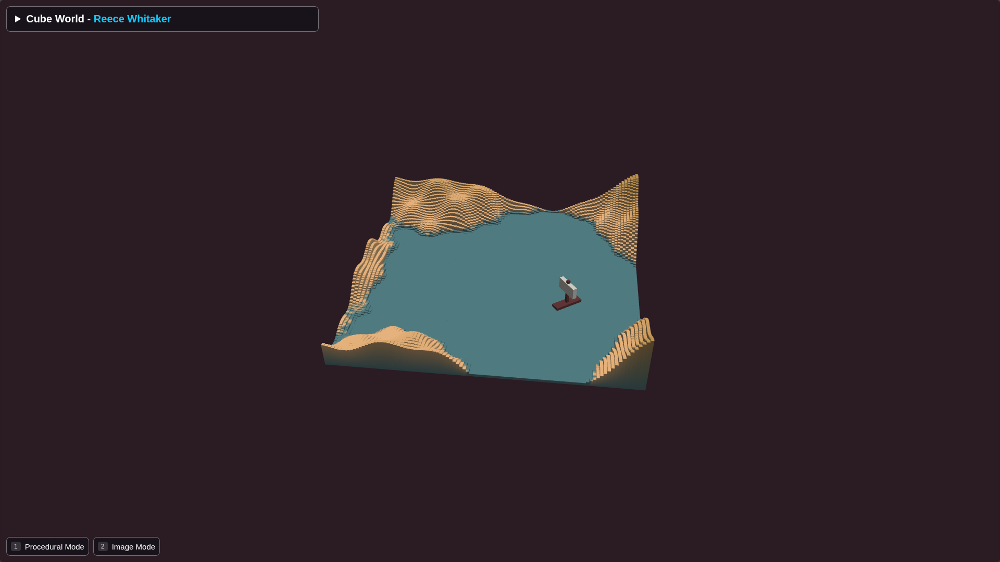
  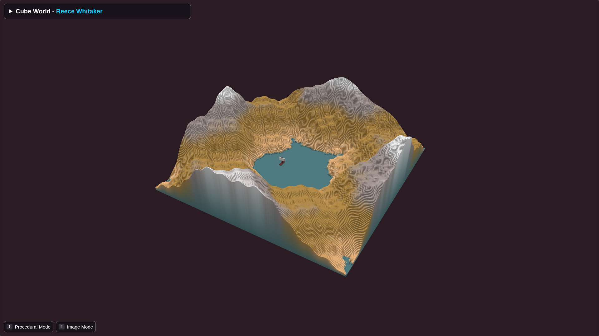
  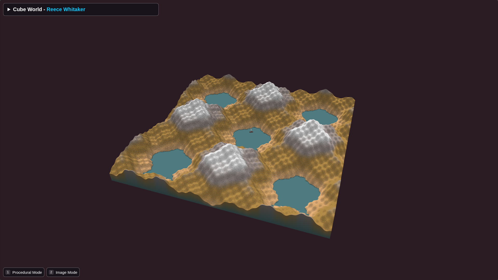
  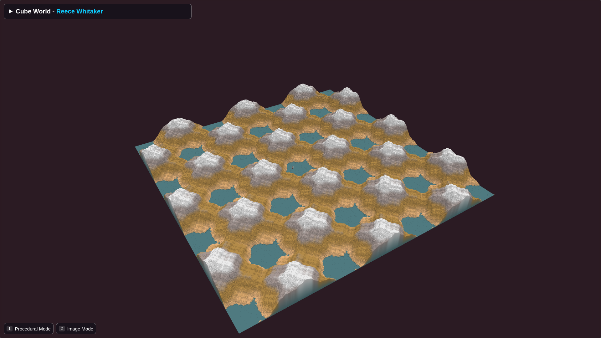
  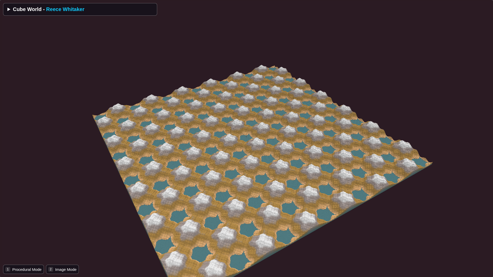
  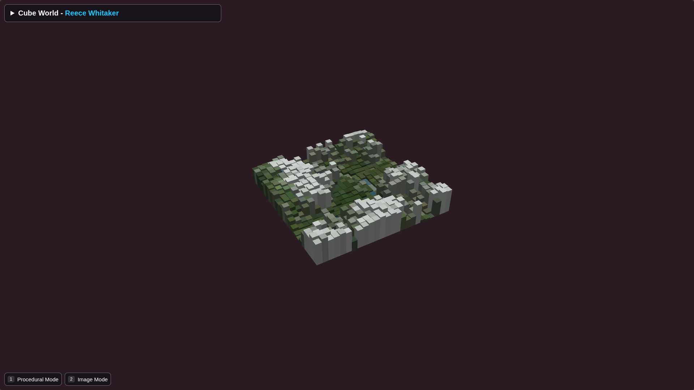
  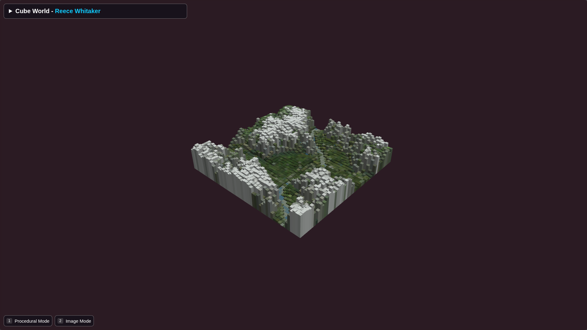
  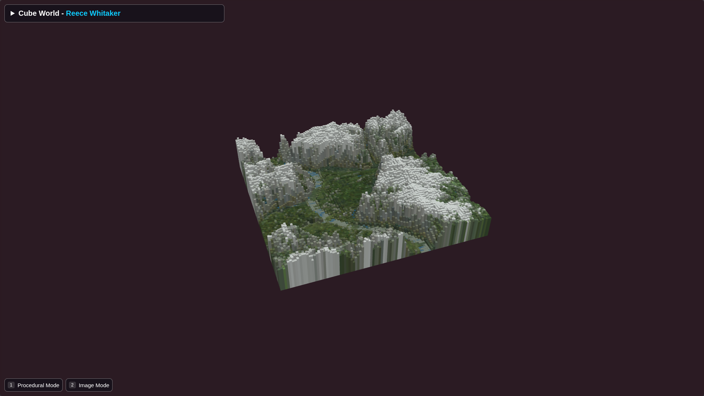
  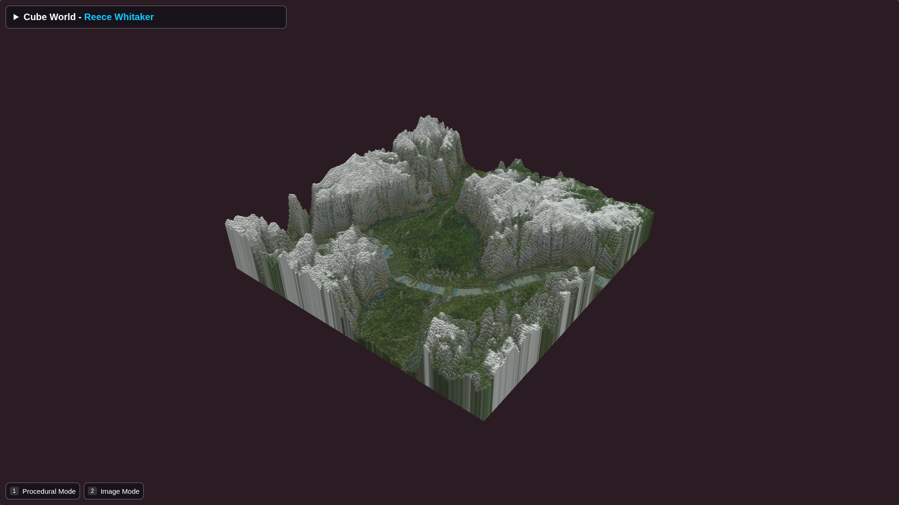
  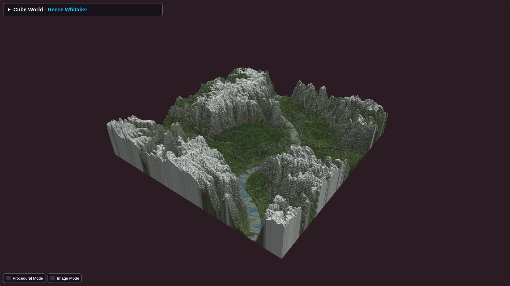
  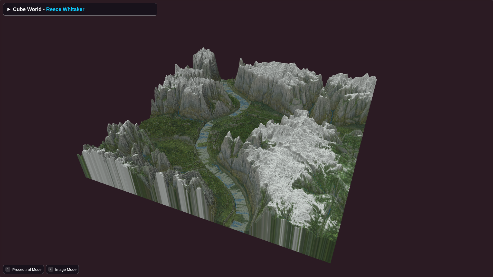
</div>

I didn't have time to build custom height and color map generation tools from scratch, so I started looking online and found a website that made it easy to both export a height map for anywhere on Earth and procedurally color that terrain based on height. Using that tool, I generated maps for Cincinnati with exaggerated heights, creating an interesting landscape that feels weirdly familiar yet alien to people who know the area.

<div style="display: flex; flex-wrap: wrap; align-items: flex-start; gap: 8px;">
  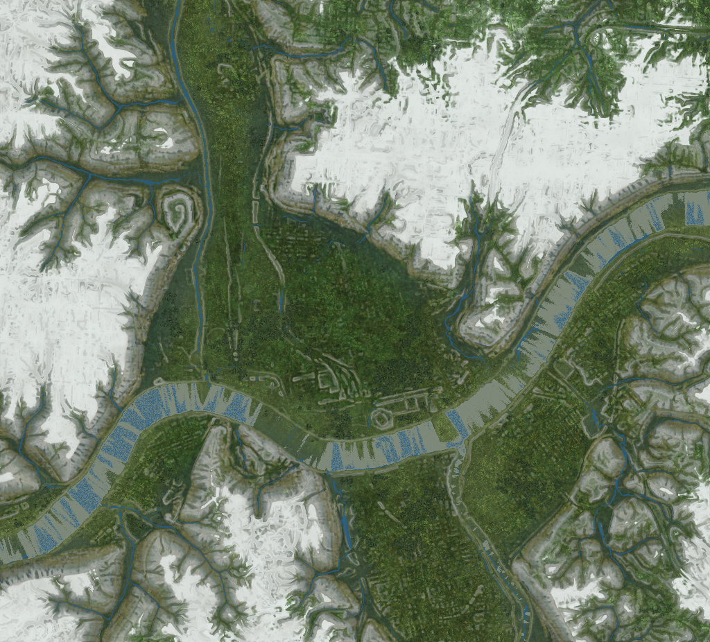
  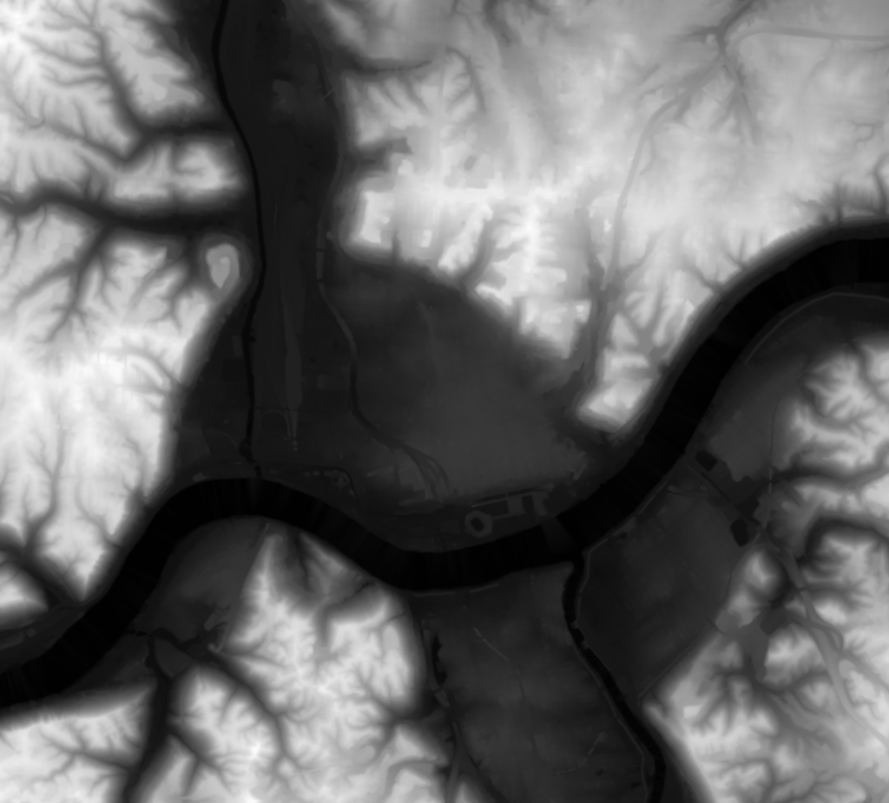
</div>


For the Bézier curve integration, I was trying to figure out how to integrate it with the growing grid size: could I somehow make the Bézier curve objects also tile and fade in as the grid does? I ended up settling on shifting the landscape to center the lake and creating a single simple boat that sits in the void prior to the world 'loading in', which ended up being a cool effect and a small focal point in the huge world.

A project like this is challenging because I wanted to optimize and max out GPU processing with shaders, but visitors to the site will have varying hardware specs. Instead of overwhelming the user with parameters and cluttering the UI, I set the default maximum grid size to a conservative number that runs well on most hardware, while adding a configurable multiplier so users can push their hardware limits to view a sprawling, tiling landscape.

Like my previous project, I spent time dialing in the colors. For most of development I used basic round RGB values, but towards the end I explored palettes from Lospec, ultimately settling on a palette based on the cartoon Hilda.

<div style="display: grid; grid-template-columns: repeat(auto-fit, minmax(min(100%, 400px), 1fr)); gap: 8px; margin-bottom: 1em;">
  <figure style="margin: 0;">
    
    <figcaption style="font-size: 0.85em; color: #909090;">hilda/final</figcaption>
  </figure>
  <figure style="margin: 0;">
    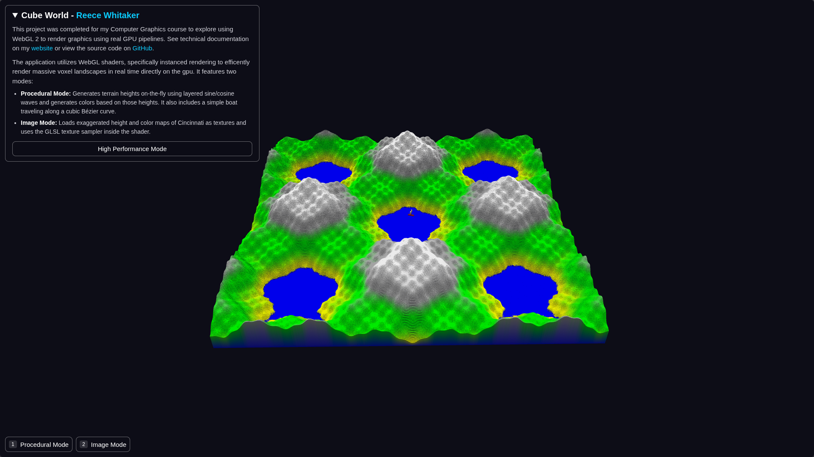
    <figcaption style="font-size: 0.85em; color: #909090;">original</figcaption>
  </figure>
  <figure style="margin: 0;">
    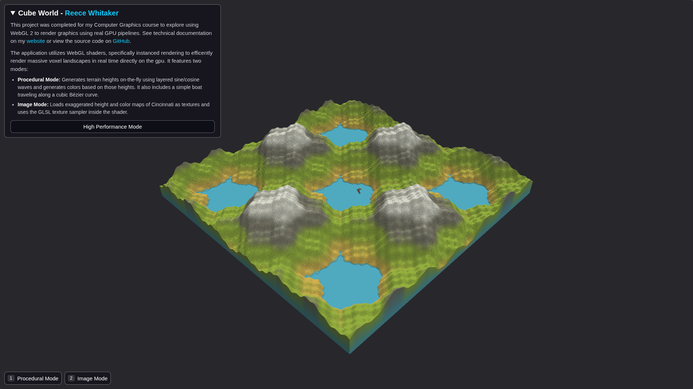
    <figcaption style="font-size: 0.85em; color: #909090;"><a href="https://lospec.com/palette-list/miyazaki-16">miyazaki</a></figcaption>
  </figure>
  <figure style="margin: 0;">
    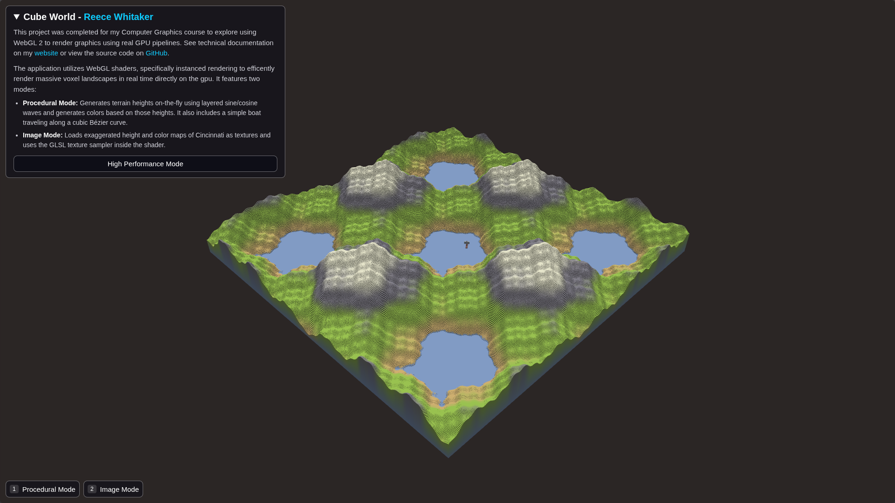
    <figcaption style="font-size: 0.85em; color: #909090;"><a href="https://lospec.com/palette-list/aragon16">aragon</a></figcaption>
  </figure>
</div>

---

## 2. Features & Controls

### 2.1 Interface & Controls

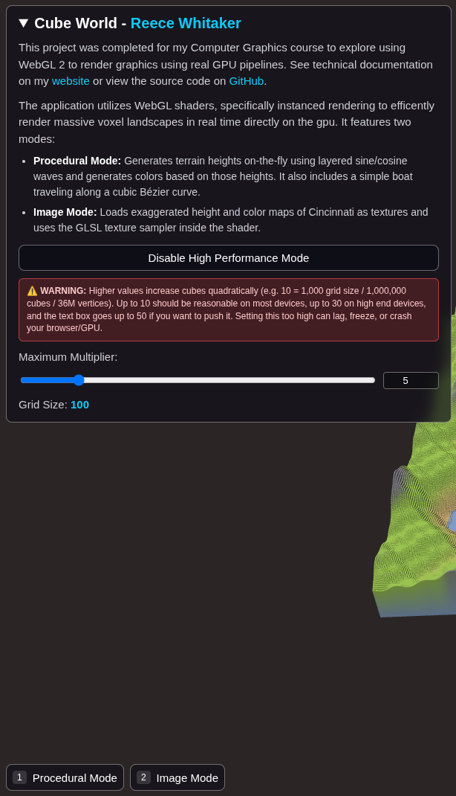

The UI consists of two simple components. 

The first component is a toggleable dropdown with project information. It also includes a button that toggles visibility of a slider and text box that allow the user to modify the grid size; this section includes a warning that setting the multiplier too high may harm performance.

The second component consists of buttons on the bottom of the screen for controlling the mode. The buttons are additionally bound to keyboard keys `1` and `2` respectively.

### 2.2 Landscape Modes

Procedural and Image modes both share the code for finding the x,z positions of the cubes, but differ in how they obtain color and height data. The code for finding color and height is toggled with a simple uniform: `0` for procedural, `1` for image.

```js
const vertexShaderSource = `#version 300 es
  // attributes
  in vec3 aPosition;
  in vec3 aNormal;

  // uniforms
  // matrices
  uniform mat4 uView;
  uniform mat4 uProjection;
  // configuration
  uniform int uMode;
  uniform int uGridSize;
  uniform float uSpacing;
  uniform float uMultiplier;
  // textures
  uniform sampler2D uHeightMap;
  uniform sampler2D uColorMap;

  // varyings
  out vec3 vNormal;
  out vec3 vColor;

  // pseudorandom noise for some x,y position
  float rand(vec2 co) { ... }
  
  // get terrain height from simple layered sine/cosine waves
  float getTerrainHeight(float x, float z) { ... }

  // blends from ocean-beach-grass-stone-snow based on height, creates variation
  // with location based noise
  vec3 terrainColor(vec3 worldPos) { ... }

  void main() {
    // get the position of the cube in the grid
    int row = gl_InstanceID / uGridSize;
    int col = gl_InstanceID % uGridSize;

    // get cube world location from grid position
    float x = (float(col) - (float(uGridSize) - 1.0) / 2.0) * uSpacing;
    float z = (float(row) - (float(uGridSize) - 1.0) / 2.0) * uSpacing;

    // set placeholders
    float height = 0.0;
    vec3 color = vec3(1.0);

    // set world position besides height
    vec4 worldPos = vec4(aPosition, 1.0);
    worldPos.x += x;
    worldPos.z += z;

    // mode 0: procedural, use getTerrainHeight for height and color
    // mode 1: image, sample textures for height and color
    if (uMode == 0) { ... }
    else { ... }

    vNormal = aNormal;
    vColor = color;

    gl_Position = uProjection * uView * worldPos;
  }
`;
```


#### **Procedural Generation Mode**:


In the procedural mode, the height is determined by a function which layers different 'octaves' of sine and cosine waves simulating hills. It also procedurally generates colors based on the height with some blending and randomization to make it look natural.

```js
const vertexShaderSource = `#version 300 es

  ...

  // pseudorandom noise for some x,y position
  float rand(vec2 co) {
    return fract(sin(dot(co, vec2(12.9315, 78.0452))) * 43758.5453);
  }

  // get terrain height from simple layered sine/cosine waves
  float getTerrainHeight(float x, float z) {
    float h = 0.0;
    float m = 150.0;
    h += sin((x-m) * 0.01) * cos(z * 0.01) * 50.0;
    h += sin((x-m) * 0.04 + 1.5) * sin(z * 0.04) * 10.0;
    h += cos((x-m) * 0.16) * sin(z * 0.16+2.3) * 2.0;

    return max(1.0, h+30.0);
  }

  // blends from ocean-beach-grass-stone-snow based on height, creates variation
  // with location based noise
  vec3 terrainColor(vec3 worldPos) {
    // define colors
    vec3 blue   = vec3(0.329, 0.522, 0.549);
    vec3 yellow = vec3(0.976, 0.761, 0.529);
    vec3 green  = vec3(0.769, 0.592, 0.302);
    vec3 grey   = vec3(0.702, 0.643, 0.624);
    vec3 white  = vec3(1.0, 1.0, 1.0);

    // get noisy height
    float noise = (rand(worldPos.xz)-0.5) * 3.0;
    float h = worldPos.y + noise;

    // get magnitude of each color
    float tYellow = smoothstep(  4.0,  5.0, h);
    float tGreen  = smoothstep( 10.0,  50.0, h);
    float tGrey   = smoothstep( 70.0, 100.0, h);
    float tWhite  = smoothstep(110.0, 140.0, h);

    // mix colors
    vec3 color = blue;
    color = mix(color, yellow, tYellow);
    color = mix(color, green, tGreen);
    color = mix(color, grey, tGrey);
    color = mix(color, white, tWhite);

    return color;
  }

  void main() {

    ...
  
    if (uMode == 0) {
      height = getTerrainHeight(x,z);
      worldPos.y *= height;
      color = terrainColor(worldPos.xyz);
    } else {
    
      ...
      
    }
    
    ...
    
  }
```

#### **Image-Based Mode**:


In image mode, the height and color are both directly sampled from textures loaded in at program start (loading of textures is discussed in detail later). In the hosted version, these are a height map of Cincinnati and procedurally generated colors from that height map, but the application can load any two images in the directory named `'heightmap.png'` and `'colormap.png'`.

```js
const vertexShaderSource = `#version 300 es

  ...

  void main() {

    ...
  
    if (uMode == 0) {

      ...
      
    } else {
      vec2 uv = vec2(float(col) / float(uGridSize-1), float(row) / float(uGridSize-1));
 
       // use equal weighting of r,g,b for height scalar
       float imgHeight = dot(texture(uHeightMap, uv).rgb, vec3(1.0/3.0));
 
       height = imgHeight * 20.0 * uMultiplier;
       color = texture(uColorMap, uv).rgb;
 
       worldPos.y *= height;
    }
    
    ...
    
  }
```

### 2.3 Camera Animation & Cycles
Everything that changes over time is driven by a standard JavaScript `requestAnimationFrame` loop. The progression of variables is driven by a few related factors: `cycleProgress` loops linearly over the cycle duration from `0.0` to `1.0`; `easeOut` is misnamed, it provides a ease in and ease out smoothing curve over `cycleProgress`; and `multiplier` is linearly mapped between `MIN_MULT` and `MAX_MULT` using `easeOut`.

The boat's position along the Bézier curve is determined by `cycleProgress`; the function that calculates the boat's position also returns an angle for its heading.

```js
function getBoatInfo(oldPos, currentTime) {
  const t = currentTime;

  // De Casteljau's algorithm for finding a point on a Bezier curve
  const a = lerp(bezier.p0, bezier.p1, t);
  const b = lerp(bezier.p1, bezier.p2, t);
  const c = lerp(bezier.p2, bezier.p3, t);

  const d = lerp(a, b, t);
  const e = lerp(b, c, t);

  const pos = lerp(d, e, t);

  // atan2 gives angle between x axis and the given 2d vector, feeding in dx, dz
  // gives the heading of the boat
  const angle = Math.atan2(pos[0] - oldPos[0], pos[2] - oldPos[2]);
  return {pos, angle};
}
```

The grid size is driven directly by `multiplier`. Using `easeOut` allows the size to grow slowly as the initial landscape is revealed, and more rapidly as it expands into a repeating pattern.

The camera follows a circular path defined by angle, radius, and height. The angle changes at a constant rate over time. Radius and height are driven by `multiplier` raised to a fractional power (< 1), maintaining a consistent visual framing of the landscape. The camera height is also clamped above a minimum threshold when the multiplier is small.

```js
function setCameraPos(camera, delta) {
  camera.pos[0] = Math.cos(delta) * camera.radius;
  camera.pos[1] = camera.height;
  camera.pos[2] = Math.sin(delta) * camera.radius;
}
```

Syncing the camera and boat to the same cycle allows the sudden jump of the boat from the end to the beginning of the Bézier curve to be seamlessly masked by the camera snapping back to its starting position.

```js
function loop(currentTime) {
  currentTime *= 0.001;
  const CYCLE_DURATION = 10.0;
  const cycleProgress = (currentTime % CYCLE_DURATION) / CYCLE_DURATION;
  const dTime = currentTime - lastTime;
  lastTime = currentTime;

  delta += camera.speed * dTime;

  const easeOut = cycleProgress * cycleProgress * (3 - 2*cycleProgress);
  multiplier = MIN_MULT + (MAX_MULT - MIN_MULT) * easeOut;

  setCameraPos(camera, delta);
  camera.radius = 400 * (multiplier ** 0.8);
  camera.height = Math.max(100, 300 * (multiplier ** 0.8));
  GRID_SIZE = parseInt(100 * multiplier);

  const {pos, angle} = getBoatInfo(boat.pos, cycleProgress);
  boat.pos = pos;
  boat.angle = angle + Math.PI/2; // adjust for x+ axis and boat heading being offset by 90 degrees

  draw();

  requestAnimationFrame(loop);
}
```

---

## 3. Technical Architecture, Implementation, & Challenges

### 3.1 WebGL2 vs. WebGL1 & Pipeline Modernization

The example code from class that I initially started working from used WebGL 1. I soon ran into limitations that are cleanly resolved in WebGL 2: requiring an extension for instanced arrays, lacking built-in `gl_InstanceID` support, and missing native integer modulo operations. I initially resisted upgrading because the WebGL 1 variable qualifier names (`uniform`, `varying`, `attribute`) felt intuitive, it avoided needing `#version 300 es`, and WebGL 1 offered broad legacy compatibility. Ultimately, the workarounds became cumbersome enough that I migrated to WebGL 2.

The most noticeable difference is in the interface qualifiers that define inputs and outputs: attributes (data changing per vertex), uniforms (constant across draw calls), and varyings (interpolated and passed to the rasterizer and fragment shader). In WebGL 1 / GLSL ES 1.00, they are explicitly named `attribute`, `uniform`, and `varying`. In WebGL 2 / GLSL ES 3.00, they are modernized to `in`, `uniform`, and `out` (with inputs to the fragment shader marked as `in`).

### 3.2 Dual Shader Programs & Vertex Array Objects (VAOs)
#### **Multi-Program Architecture**:
Due to optimizing height and color computations directly inside the terrain vertex shader, I could not cleanly reuse the same shader program to draw the boat, requiring a dedicated secondary program. This necessitated a clear mental model of WebGL GPU state and pipeline execution rather than relying on boilerplate setup code. While initially challenging, working through it solidified my understanding of the graphics pipeline.

We configure separate WebGL programs and Vertex Array Objects (VAOs) for the terrain and boat. Each program maintains its own vertex shader, while sharing a unified fragment shader since both simply pass interpolated colors through to the screen.

VAOs dramatically streamline state switching: rather than manually re-binding vertex buffers and attribute pointers on every draw call or program switch, the bindings are encapsulated in the VAO and restored with a single `bindVertexArray` call.

#### **WebGL GPU State & Order of Operations**:

For each program, shaders must be compiled and attached, and uniform locations are cached during initialization for efficient updates during rendering:

```js
// --------------- PROGRAMS SETUP ---------------

const program = gl.createProgram();
gl.attachShader(program, compileShader(gl.VERTEX_SHADER, vertexShaderSource));
gl.attachShader(program, compileShader(gl.FRAGMENT_SHADER, fragmentShaderSource));
gl.linkProgram(program);

const boatProgram = gl.createProgram();
gl.attachShader(boatProgram, compileShader(gl.VERTEX_SHADER, simpleVertexShaderSource));
gl.attachShader(boatProgram, compileShader(gl.FRAGMENT_SHADER, fragmentShaderSource));
gl.linkProgram(boatProgram);

// setup buffer
const buffer = gl.createBuffer();
gl.bindBuffer(gl.ARRAY_BUFFER, buffer);
gl.bufferData(gl.ARRAY_BUFFER, cubeVertices, gl.STATIC_DRAW);

...

// --------------- UNIFORM CACHE LOCATIONS ---------------

gl.useProgram(program);
const uView = gl.getUniformLocation(program, 'uView');
const uProjection = gl.getUniformLocation(program, 'uProjection');
const uGridSize = gl.getUniformLocation(program, 'uGridSize');
const uSpacing = gl.getUniformLocation(program, 'uSpacing');
const uHeightMap = gl.getUniformLocation(program, 'uHeightMap');
const uColorMap = gl.getUniformLocation(program, 'uColorMap');
const uMode = gl.getUniformLocation(program, 'uMode');
const uMultiplier = gl.getUniformLocation(program, 'uMultiplier');

gl.useProgram(boatProgram);
const boatUModel = gl.getUniformLocation(boatProgram, 'uModel');
const boatUView = gl.getUniformLocation(boatProgram, 'uView');
const boatUProjection = gl.getUniformLocation(boatProgram, 'uProjection');
const boatUColor = gl.getUniformLocation(boatProgram, 'uColor');

```

For each VAO, vertex attribute pointers must be configured. This requires binding the target data buffer, enabling the attribute slot, and specifying the memory layout (stride and offset). While the final architecture shares one vertex buffer containing base cube data, an earlier iteration fed instance transform matrices through vertex attributes, requiring multi-slot attribute configurations:

```js
// --------------- VERTEX ARRAY OBJECTS (VAO) SETUP ---------------

// VAO for program
const VAO = gl.createVertexArray();

gl.bindVertexArray(VAO);
gl.bindBuffer(gl.ARRAY_BUFFER, buffer);

const aPosition = gl.getAttribLocation(program, 'aPosition');
gl.enableVertexAttribArray(aPosition);
gl.vertexAttribPointer(aPosition, 3, gl.FLOAT, false, stride, 0);

const aNormal = gl.getAttribLocation(program, 'aNormal');
gl.enableVertexAttribArray(aNormal);
gl.vertexAttribPointer(aNormal, 3, gl.FLOAT, false, stride, 3 * BYTES_PER_FLOAT);

// VAO for boatProgram

const boatVAO = gl.createVertexArray();

gl.bindVertexArray(boatVAO);
gl.bindBuffer(gl.ARRAY_BUFFER, buffer);

const boatAPosition = gl.getAttribLocation(boatProgram, 'aPosition');
gl.enableVertexAttribArray(boatAPosition);
gl.vertexAttribPointer(boatAPosition, 3, gl.FLOAT, false, stride, 0);

const boatANormal = gl.getAttribLocation(boatProgram, 'aNormal');
gl.enableVertexAttribArray(boatANormal);
gl.vertexAttribPointer(boatANormal, 3, gl.FLOAT, false, stride, 3 * BYTES_PER_FLOAT);

// ---------------- MATRIX ATTRIBUTES EXAMPLE -------------------
// Textual explanation of this later in documentation where I discussed when this 
// was actually in the code at one step in the optimization process
 
// bind matrix data to buffer
const matrixBuffer = gl.createBuffer();
gl.bindBuffer(gl.ARRAY_BUFFER, matrixBuffer);
gl.bufferData(gl.ARRAY_BUFFER, modelMatricesNew, gl.STATIC_DRAW);

const MATRIX_STRIDE = 16 * BYTES_PER_FLOAT;

// define matrix data format
const aModel = gl.getAttribLocation(program, 'aModel');
for (let i = 0; i < 4; i++) {
  const loc = aModel + i;
  gl.enableVertexAttribArray(loc);
  gl.vertexAttribPointer(
    loc,                    // which slot
    4,                      // numbers per vertex (i.e. the 4 floats in one column)
    gl.FLOAT,               // type of numbers
    false,                  // whether to normalize
    MATRIX_STRIDE,          // stride, distance between starting position of one slot 
                            // and the starting point of that slot's next element
    i * 4 * BYTES_PER_FLOAT // offset, start point of first element in data
  );

  gl.vertexAttribDivisor(loc, 1);
}
```

Texture units also require explicit binding. In this project, texture bindings remain constant across execution, but multi-texture pipelines require binding textures to designated active units:

```js
// ------------- BIND CONSTANT TEXTURES AND UNIFORMS -------------

// bind textures
gl.activeTexture(gl.TEXTURE0);
gl.bindTexture(gl.TEXTURE_2D, heightMapTexture);

gl.activeTexture(gl.TEXTURE1);
gl.bindTexture(gl.TEXTURE_2D, colorMapTexture);
```


During drawing, uniforms must be dispatched to their corresponding program:

```js
// bind constant uniforms
gl.useProgram(program);
gl.uniform1i(uHeightMap, 0);
gl.uniform1i(uColorMap, 1);
gl.uniform1f(uSpacing, SPACING);

...

function draw() {

  ...

  gl.uniformMatrix4fv(uProjection, false, perspectiveMatrix);
  gl.uniformMatrix4fv(uView, false, viewMatrix);

  ...

  if (mode == 'procedural') {
    
    ...

    gl.uniformMatrix4fv(boatUProjection, false, perspectiveMatrix);
    gl.uniformMatrix4fv(boatUView, false, viewMatrix);

    drawBoat(boat.pos, boat.angle);
  }
}

function drawBoat(position, theta) {

  ...

  gl.uniformMatrix4fv(boatUModel, false, model);
  gl.uniform3fv(boatUColor, BOAT_COLOR);
  gl.drawArrays(gl.TRIANGLES, 0, VERTEX_COUNT);

  ...
  
}

```

Once I mapped out which functions affect global WebGL state versus program or VAO state, organizing the rendering pipeline became clean and modular.

### 3.3 Boat Rendering

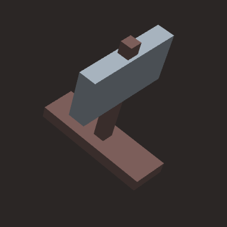

The boat is composed of three cubes drawn using a standard model-view-projection vertex shader across three draw calls:

```js
const simpleVertexShaderSource = `#version 300 es
  in vec3 aPosition;
  in vec3 aNormal;

  uniform mat4 uModel;
  uniform mat4 uView;
  uniform mat4 uProjection;
  uniform vec3 uColor;

  out vec3 vNormal;
  out vec3 vColor;

  void main() {
    vNormal = aNormal;
    vColor = uColor;
    gl_Position = uProjection * uView * uModel * vec4(aPosition, 1.0);
  }
`;

...

function drawBoat(position, theta) {
  // body
  let model = modelMatrix(
    translation(...position),
    scaling(10, 1, 3),
    rotationY(theta),
  );
  gl.uniformMatrix4fv(boatUModel, false, model);
  gl.uniform3fv(boatUColor, BOAT_COLOR);
  gl.drawArrays(gl.TRIANGLES, 0, VERTEX_COUNT);

  // mast
  model = modelMatrix(
    translation(...position),
    scaling(1,10,1),
    rotationY(theta),
  );
  gl.uniformMatrix4fv(boatUModel, false, model);
  gl.uniform3fv(boatUColor, BOAT_COLOR);
  gl.drawArrays(gl.TRIANGLES, 0, VERTEX_COUNT);

  // sail
  model = modelMatrix(
    translation(position[0], position[1] + 10, position[2]),
    scaling(1.5,4,8),
    rotationY(theta),
  );
  gl.uniformMatrix4fv(boatUModel, false, model);
  gl.uniform3fv(boatUColor, SAIL_COLOR);
  gl.drawArrays(gl.TRIANGLES, 0, VERTEX_COUNT);
}
```

### 3.4 Shading

<div style="display: flex; flex-wrap: wrap; align-items: flex-start; gap: 8px;">
  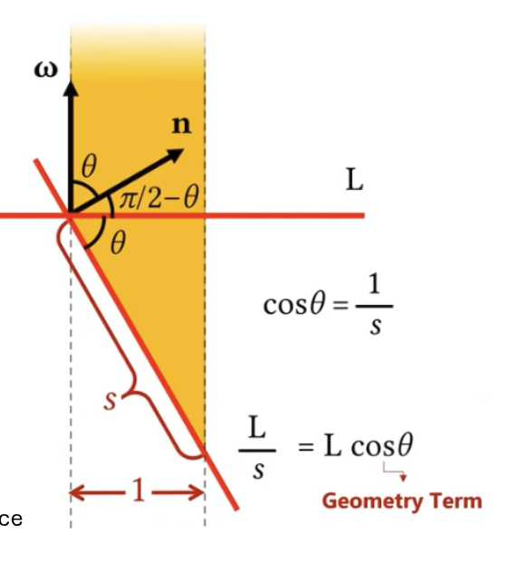
  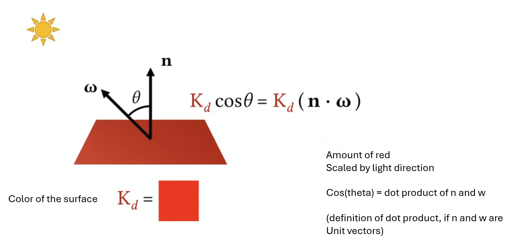
</div>

The fragment shader implements simple Lambertian diffuse lighting by computing the dot product between the surface normal and the normalized light direction, approximating the projected surface area receiving incident light. Because repetitive cube terrain can produce harsh shading artifacts depending on incident angle, the light vector was chosen to emphasize geometric relief while avoiding visual clutter.

The final lighting intensity is clamped to a minimum value of `0.4` to provide ambient fill lighting, keeping the scene bright and outdoorsy.

```js
const fragmentShaderSource = `#version 300 es
  precision mediump float;

  in vec3 vNormal;
  in vec3 vColor;

  out vec4 fragColor;

  void main() {
    vec3 lightDirection = normalize(vec3(0.4,0.9,0.3));

    float brightness = max(dot(vNormal, lightDirection), 0.0);

    float light = min(0.4 + 0.6 * brightness, 1.0);

    fragColor = vec4(vColor*light, 1.0);
  }
`;
```


### 3.5 Instanced Rendering & Optimization Journey

A major milestone of this project was optimizing the initial starter code from being bottlenecked by CPU/RAM at 500²–1000² cubes to scaling smoothly up to GPU limits (10,000²+ cubes).

The initial starter code recomputed individual model matrices for every single cube on the CPU each frame. This resulted in low frame rates even at small grid dimensions:

```js
const cubes = [];
for (let row = 0; row < GRID_SIZE; row++) {
  for (let col = 0; col < GRID_SIZE; col++) {
    x = (col - (GRID_SIZE - 1) / 2) * SPACING;
    z = (row - (GRID_SIZE - 1) / 2) * SPACING;
    cubes.push({
      x: (col - (GRID_SIZE - 1) / 2) * SPACING,
      z: (row - (GRID_SIZE - 1) / 2) * SPACING,
      //height: 0.5 + Math.random() * 75 / 2,
      height: getTerrainHeight(x, z),
      color: [Math.random(), Math.random(), Math.random()],
    })
  }
}

...

function draw() {

  ...
  
  drawCubes();
}

function drawCubes() {
  for (const cube of cubes) {
    const model = multiply(
      translation(cube.x, 0, cube.z),
      scaling(1, cube.height, 1),
    )

    drawCube(model, cube.color);
  }
}

function drawCube(model, color) {
  gl.uniformMatrix4fv(uModel, false, model);

  gl.uniform3fv(uColor, color);

  gl.drawArrays(gl.TRIANGLES, 0, VERTEX_COUNT);
}

```

My first optimization moved matrix computation outside of the per-frame render loop. This stabilized framerates at modest sizes, but still hit a hard CPU bottleneck because every cube required its own WebGL draw call:

```js
// define model matrices for all cube instances 
// (used to translate and scale from object space to world space)
const modelMatrices = []
for (const cube of cubes) {
  const model = multiply(
    translation(cube.x, 0, cube.z),
    scaling(1, cube.height, 1),
  )

  modelMatrices.push(model);
}

function drawCubes() {
  for (const model of modelMatrices) {
    drawCube(model, [0, 0, 0]);
  }
}

function drawCube(model, color) {
  gl.uniformMatrix4fv(uModel, false, model);

  gl.uniform3fv(uColor, color);

  gl.drawArrays(gl.TRIANGLES, 0, VERTEX_COUNT);
}
```

Next, I implemented instanced rendering via `gl.drawArraysInstanced`. Model matrices were packed into a buffer and bound as vertex attributes, converting uniform `uModel` into attribute `aModel` with `vertexAttribDivisor(loc, 1)`. This reduced all cube rendering to a single draw call executed in parallel across GPU cores. While rendering was fast, computing millions of matrices upfront on the CPU caused sluggish startup times and quickly exhausted browser memory limits.

Configuring matrix attributes in WebGL requires special handling because each vertex attribute slot holds at most 4 floats, meaning a 4x4 matrix must be allocated across 4 consecutive attribute locations:

```js
const modelMatricesNew = new Float32Array(GRID_SIZE * GRID_SIZE * 16);
for (let row = 0; row < GRID_SIZE; row++) {
  for (let col = 0; col < GRID_SIZE; col++) {
    let index = row * GRID_SIZE + col;
    let x = (col - (GRID_SIZE - 1) / 2) * SPACING;
    let z = (row - (GRID_SIZE - 1) / 2) * SPACING;
    let height = getTerrainHeight(x, z)

    const model = multiply(
      translation(x, 0, z),
      scaling(1, height, 1),
    )

    modelMatricesNew.set(model, index * 16);
  }
}

// bind matrix data to buffer
const matrixBuffer = gl.createBuffer();
gl.bindBuffer(gl.ARRAY_BUFFER, matrixBuffer);
gl.bufferData(gl.ARRAY_BUFFER, modelMatricesNew, gl.STATIC_DRAW);

const MATRIX_STRIDE = 16 * BYTES_PER_FLOAT;

// define matrix data format
const aModel = gl.getAttribLocation(program, 'aModel');
for (let i = 0; i < 4; i++) {
  const loc = aModel + i;
  gl.enableVertexAttribArray(loc);
  gl.vertexAttribPointer(
    loc,                    // which slot
    4,                      // numbers per vertex (i.e. the 4 floats in one column)
    gl.FLOAT,               // type of numbers
    false,                  // whether to normalize
    MATRIX_STRIDE,          // stride, distance between starting position of one slot 
                            // and the starting point of that slot's next element
    i * 4 * BYTES_PER_FLOAT // offset, start point of first element in data
  );

  gl.vertexAttribDivisor(loc, 1);
}

function drawCubes() {
 gl.drawArraysInstanced(
      gl.TRIANGLES,
      0,
      VERTEX_COUNT,
      GRID_SIZE * GRID_SIZE,
    );
}
```

Finally, I eliminated CPU model matrices altogether and computed cube instance positions directly inside the vertex shader using `gl_InstanceID`. This made memory consumption negligible and eliminated startup latency, allowing dynamic grid sizing at runtime with performance bounded strictly by GPU throughput.

### 3.6 Vertex Shader Textures

Computing instance geometry directly on the GPU also simplified the height and color map pipelines. Images are uploaded to texture memory once at startup, allowing the vertex shader to sample elevation and color data directly via normalized UV coordinates:

```js
// --------------- LOAD TEXTURES ---------------

function loadTexture(gl, url) {
  const texture = gl.createTexture();
  gl.bindTexture(gl.TEXTURE_2D, texture);

  // set texture to single magenta pixel while waiting to load
  gl.texImage2D(
    gl.TEXTURE_2D,
    0,
    gl.RGBA,
    1,
    1,
    0,
    gl.RGBA,
    gl.UNSIGNED_BYTE,
    new Uint8Array([128, 128, 128, 255]),
  );

  const image = new Image();
  image.crossOrigin = 'anonymous';
  image.onload = () => {
    gl.bindTexture(gl.TEXTURE_2D, texture);

    gl.texImage2D(
      gl.TEXTURE_2D,
      0,
      gl.RGBA,
      gl.RGBA,
      gl.UNSIGNED_BYTE,
      image,
    );

    // set webgl texture settings
    gl.texParameteri(gl.TEXTURE_2D, gl.TEXTURE_WRAP_S, gl.CLAMP_TO_EDGE);
    gl.texParameteri(gl.TEXTURE_2D, gl.TEXTURE_WRAP_T, gl.CLAMP_TO_EDGE);
    gl.texParameteri(gl.TEXTURE_2D, gl.TEXTURE_MIN_FILTER, gl.LINEAR);
    gl.texParameteri(gl.TEXTURE_2D, gl.TEXTURE_MAG_FILTER, gl.LINEAR);
  };
  image.src = url;

  return texture;
}

const heightMapTexture = loadTexture(gl, 'assets/heightmap.png');
const colorMapTexture = loadTexture(gl, 'assets/colormap.png');

...

const vertexShaderSource = `#version 300 es

  ...
  
  void main() {

    ...

    // mode 0: procedural, use getTerrainHeight for height and color
    // mode 1: image, sample textures for height and color
    if (uMode == 0) {

      ...
    } else {
      vec2 uv = vec2(float(col) / float(uGridSize-1), float(row) / float(uGridSize-1));

      // use equal weighting of r,g,b for height scalar
      float imgHeight = dot(texture(uHeightMap, uv).rgb, vec3(1.0/3.0));

      height = imgHeight * 20.0 * uMultiplier;
      color = texture(uColorMap, uv).rgb; // Sample texture at location uv

      worldPos.y *= height;
    }

  }

gl.uniform1i(uHeightMap, 0);
gl.uniform1i(uColorMap, 1);
```

### 3.7 Matrix Generation and Operations

All matrix math and linear algebra transformations outside of the shader are implemented from scratch:

```js
// Move a point by (x, y, z).
function translation(x, y, z) {
  return [
    1, 0, 0, 0,
    0, 1, 0, 0,
    0, 0, 1, 0,
    x, y, z, 1,
  ];
}

// Stretch a point by (sx, sy, sz).
function scaling(sx, sy, sz) {
  return [
    sx, 0,  0,  0,
    0,  sy, 0,  0,
    0,  0,  sz, 0,
    0,  0,  0,  1,
  ];
}

// Rotate by theta radians around y (up) axis
function rotationY(theta) {
  const c = Math.cos(theta);
  const s = Math.sin(theta);

  return [
    c, 0, -s, 0,
    0, 1,  0, 0,
    s, 0,  c, 0,
    0, 0,  0, 1,
  ];
}

// Multiply two matrices: the result does b first, then a.
function multiply(a, b) {
  const result = new Array(16).fill(0);
  for (let col = 0; col < 4; col++) {
    for (let row = 0; row < 4; row++) {
      for (let k = 0; k < 4; k++) {
        result[col * 4 + row] += a[k * 4 + row] * b[col * 4 + k];
      }
    }
  }
  return result;
}

// combine translation, scaling, and rotation for full model matrix
function modelMatrix(translate, scale, rotate) {
  return multiply(
    translate,
    multiply(
      rotate,
      scale,
    ),
  );
}

// get perspective matrix
// fieldOfView in radians
function perspective(fieldOfView, aspect, near, far) {
  const f = 1 / Math.tan(fieldOfView / 2);
  return [
    f / aspect, 0, 0,                               0,
    0,          f, 0,                               0,
    0,          0, (far + near) / (near - far),    -1,
    0,          0, (2 * far * near) / (near - far), 0,
  ];
}

// get view matrix
function lookAt(eye, target, up) {
  const subtract = (a, b) => [a[0] - b[0], a[1] - b[1], a[2] - b[2]];
  const dot = (a, b) => a[0] * b[0] + a[1] * b[1] + a[2] * b[2];
  const cross = (a, b) => [
    a[1] * b[2] - a[2] * b[1],
    a[2] * b[0] - a[0] * b[2],
    a[0] * b[1] - a[1] * b[0],
  ];
  const normalize = (a) => {
    const length = Math.hypot(a[0], a[1], a[2]);
    return [a[0] / length, a[1] / length, a[2] / length];
  };

  const zAxis = normalize(subtract(eye, target));
  const xAxis = normalize(cross(up, zAxis));
  const yAxis = cross(zAxis, xAxis);

  return [
    xAxis[0], yAxis[0], zAxis[0], 0,
    xAxis[1], yAxis[1], zAxis[1], 0,
    xAxis[2], yAxis[2], zAxis[2], 0,
    -dot(xAxis, eye), -dot(yAxis, eye), -dot(zAxis, eye), 1,
  ]
}
```

---

## 4. Application of Course Concepts

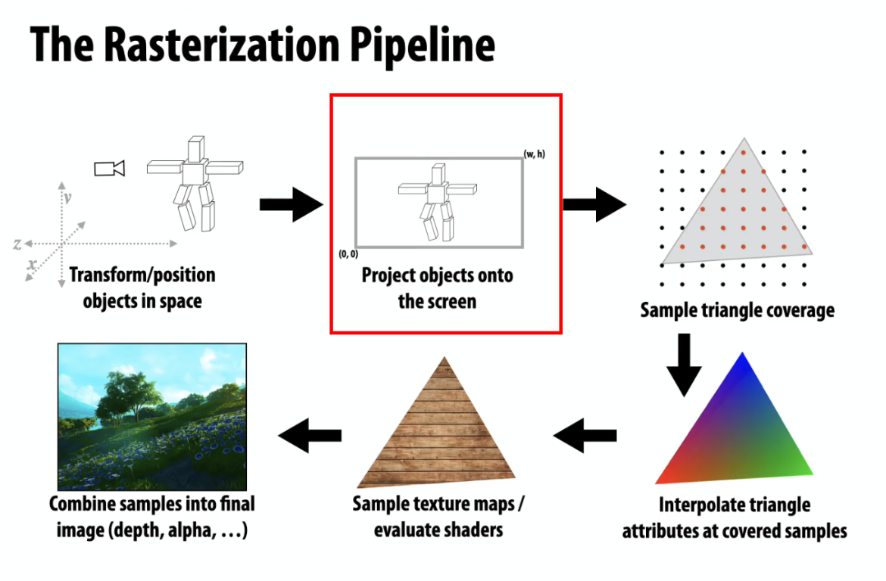

### 4.1 Graphics Pipeline

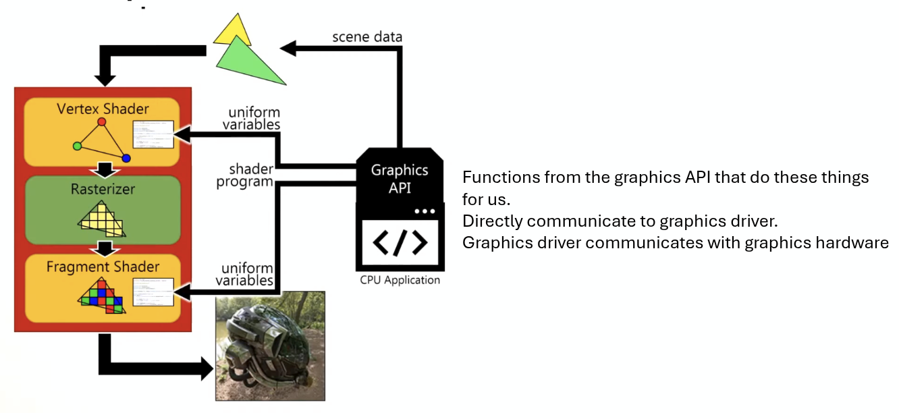

In class we explored the sequential stages of the graphics pipeline. In this application, geometry begins as vertex and normal data supplied to the vertex shader. The vertex shader outputs clip-space coordinates into `gl_Position`, which are then consumed by hardware rasterization. Rasterization determines triangle coverage across pixels and interpolates varyings across the primitive's surface. Finally, the fragment shader computes output colors for each rasterized fragment.

While real-world pipelines offer programmable geometry/tessellation shaders and complex rasterizer states, this core vertex-to-fragment pipeline drives all visual output in the project.

### 4.2 3D Geometry & Representation

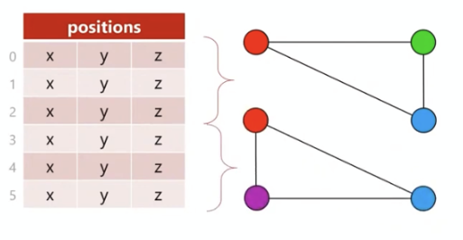

3D objects in this project are represented as vertex arrays pairing positions with surface normals, with every 3 consecutive vertices defining a triangle. We configure WebGL attribute pointers to parse this interleaved data, instructing `gl.drawArrays` to interpret the data as triangles. With this explicit representation, a cube is defined by 36 vertices (6 faces × 2 triangles per face):

```js
const cubeVertices = new Float32Array([
  // Front face (normal points toward +z)
  -1, 0, 1,   0, 0, 1,
   1, 0, 1,   0, 0, 1,
   1, 2, 1,   0, 0, 1,
  -1, 0, 1,   0, 0, 1,
   1, 2, 1,   0, 0, 1,
  -1, 2, 1,   0, 0, 1,

  // Back face (-z)
  -1, 0, -1,  0, 0, -1,
   1, 2, -1,  0, 0, -1,
   1, 0, -1,  0, 0, -1,
  -1, 0, -1,  0, 0, -1,
  -1, 2, -1,  0, 0, -1,
   1, 2, -1,  0, 0, -1,

  // Top face (+y)
  -1, 2, -1,  0, 1, 0,
  -1, 2,  1,  0, 1, 0,
   1, 2,  1,  0, 1, 0,
  -1, 2, -1,  0, 1, 0,
   1, 2,  1,  0, 1, 0,
   1, 2, -1,  0, 1, 0,

  // Bottom face (-y)
  -1, 0, -1,  0, -1, 0,
   1, 0,  1,  0, -1, 0,
  -1, 0,  1,  0, -1, 0,
  -1, 0, -1,  0, -1, 0,
   1, 0, -1,  0, -1, 0,
   1, 0,  1,  0, -1, 0,

  // Right face (+x)
   1, 0, -1,  1, 0, 0,
   1, 2, -1,  1, 0, 0,
   1, 2,  1,  1, 0, 0,
   1, 0, -1,  1, 0, 0,
   1, 2,  1,  1, 0, 0,
   1, 0,  1,  1, 0, 0,

  // Left face (-x)
  -1, 0, -1, -1, 0, 0,
  -1, 2,  1, -1, 0, 0,
  -1, 2, -1, -1, 0, 0,
  -1, 0, -1, -1, 0, 0,
  -1, 0,  1, -1, 0, 0,
  -1, 2,  1, -1, 0, 0,
]);
const VERTEX_COUNT = 36;
```

### 4.3 Transformations & Camera Model

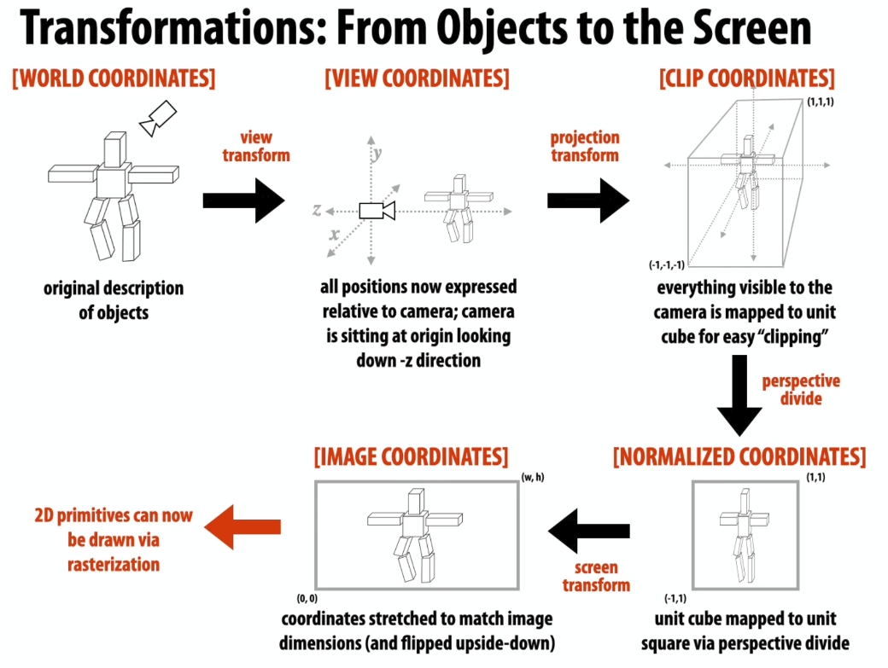

We follow the standard 3D transformation pipeline: Object Space → World Space → View Space → Clip Space, transformed by the model matrix, view matrix, and perspective projection matrix respectively.

Specifically:
- **World Space** positions local models within the shared scene.
- **View Space** transforms coordinates relative to a virtual camera placed at the origin.
- **Clip Space** maps view-space coordinates into a normalized clip box ([-1, 1]) while applying perspective foreshortening.

For the cube grid, world positions are derived procedurally inside the vertex shader, eliminating CPU model transformation overhead.

### 4.4 Curves & Splines
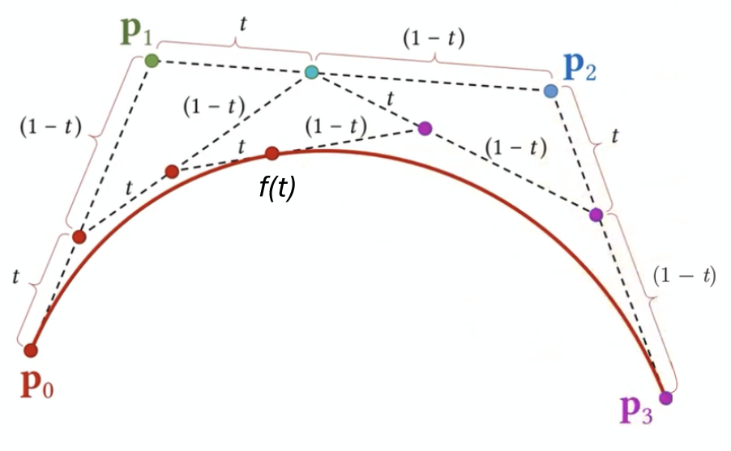

The boat moves along a cubic Bézier curve, evaluated using De Casteljau's algorithm:

```js
const lerp = (a, b, t) => a.map((n, i) => n + (b[i] - n) * t);

function getBoatInfo(oldPos, currentTime) {
  const t = currentTime;

  // De Casteljau's algorithm for finding a point on a Bezier curve
  const a = lerp(bezier.p0, bezier.p1, t);
  const b = lerp(bezier.p1, bezier.p2, t);
  const c = lerp(bezier.p2, bezier.p3, t);

  const d = lerp(a, b, t);
  const e = lerp(b, c, t);

  const pos = lerp(d, e, t);

  // atan2 gives angle between x axis and the given 2d vector, feeding in dx, dz
  // gives the heading of the boat
  const angle = Math.atan2(pos[0] - oldPos[0], pos[2] - oldPos[2]);
  return {pos, angle};
}
```

---

## 5. Future Work

The following is a non-exhaustive list of ideas for future improvements:

- Pass more parameters to the user for customization (landscape multipliers, Bézier control points, height multiplier, etc.)
- Add atmospheric fog and depth haze
- Create a composite, multi-segment Bézier curve for more intricate boat paths
- Further optimize cube geometry (using indexed vertex buffers / element arrays to eliminate redundant vertices)
- Implement more advanced shading (specular highlights, shadows, directional ambient)
- Support arbitrary custom image upload for height/color maps
- Generalize engine code with higher-level abstractions and modularity
- Allow the boat to traverse infinitely across the repeating tiled landscape
- Implement GPU-based 3D Perlin/simplex noise for organic terrain synthesis
- Optimize boat rendering via instancing
- Multiple selectable color palettes

---

## 6. Credits & Resources

- **WebGL2 Tutorials & References**: [WebGL2 Fundamentals Instanced Drawing Tutorial](https://webgl2fundamentals.org/webgl/lessons/webgl-instanced-drawing.html) and related guides.
- **Color Palette**: [Hilda32 on Lospec](https://lospec.com/palette-list/hilda32)
- **Map Assets**: Maps created with [3D Map Generator - Free Heightmap Generator](https://3d-map-generator.com/free-heightmap-generator/) and [3D Map Generator - Terrain Maker 3D](https://3d-map-generator.com/3d-map-generator-app/terrain_maker_3d/)
- **Tools**: Zed IDE with Antigravity CLI integration
- **AI Assistance**: Gemini Flash (details below)

---

## 7. AI Disclosure

I wrote the project code myself, but I turned to AI as a learning assistant and sounding board whenever I encountered unfamiliar WebGL concepts or hit a roadblock.

### Setup and Workflow
Throughout development, I kept a single, continuous Gemini Flash chat open in my IDE sidebar (accumulating around 500k tokens of context). My standard workflow was to ask for illustrative code examples, break them down until I fully understood what every line was doing, and then implement the solution in my project. While models can occasionally hallucinate (particularly smaller ones like Flash), being able to ask specific questions and get immediate, targeted explanations made learning WebGL significantly faster and more intuitive than staring at documentation for hours. In particular, it was essential in helping me understand how WebGL operates under the hood—especially binding buffers, programs, and vertex array objects (VAOs), as well as configuring attribute pointers.

AI was also extremely helpful in deciphering obtuse error messages and expediting root-cause debugging.

### Math and Formulas
For mathematical formulas, I generally attempted to derive them myself first. When I struggled, I used AI to generate a baseline formula and then tweaked it to fit my needs. For example, the mathematical formulas for the procedural terrain generation were initially generated by AI, but I adjusted the constants and added positional offsets to center and shape the terrain to match my vision.

### Implementation Examples & Critical Judgment
- **Direct Adoption with Review (Image Mode & Texture Sampling):** When working out how to implement the image-based terrain mode, AI generated example code for loading and sampling textures and toggling between procedural and image modes. I walked through the example to ensure I understood every line before integrating it; because the proposed structure matched what I had in mind almost exactly, I adopted it closely.
- **Overriding and Rewriting (Multiplier Controls):** In other instances, I had to exercise judgment and override the model's output. When I asked it to add UI controls for the maximum multiplier and wire them into the JavaScript, the generated code was unnecessarily overcomplicated and directly modified the grid size instead of the multiplier. I heavily rewrote the UI and state logic myself to fit my intended design and eliminate unnecessary bloat.
- **Refactoring and Cleanup:** AI also helped streamline the final cleanup phase—identifying dead code, improving code structure, and keeping the codebase tidy and readable.

### Documentation
I brainstormed the topics I wanted to discuss and AI organized them into an outline skeleton which I filled out. I then used it to refine select passages, editing the output to preserve my own voice and technical accuracy.
